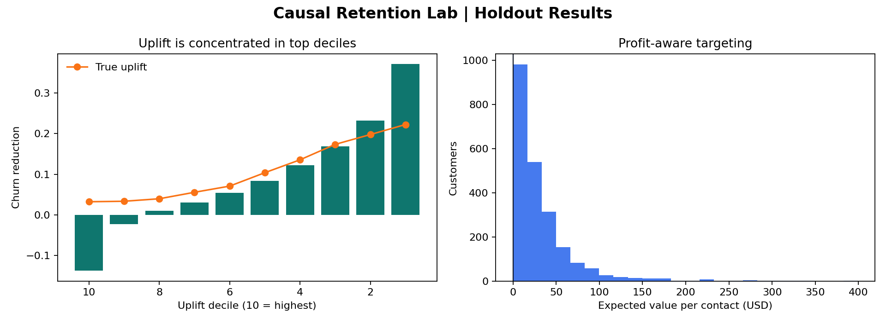

# Causal Retention Lab

Choosing who receives a retention offer requires estimating who will change their behavior, not just who might leave.


I generated a randomized SaaS retention experiment with known treatment effects, then trained separate response models for contacted and uncontacted customers. Their predicted difference becomes an estimated churn reduction. A contact is recommended when that reduction, multiplied by retained margin, exceeds the offer cost.



## Results on simulated data

The holdout has 3,920 customers. The policy selects 2,234 of them and estimates $70,120.78 in incremental profit under the simulation's margin and cost assumptions. This is a model estimate, not observed company revenue.

| Holdout result | Value |
|---|---:|
| Customers targeted | 2,234 of 3,920 |
| Expected incremental profit | $70,120.78 |
| Uplift rank correlation | 0.6465 |
| Control / treatment ROC AUC | 0.6729 / 0.7228 |

The chart compares predicted uplift with the known effect across customer groups. Ranking works reasonably well, though the highest decile is overestimated. That gap matters: a real campaign would need an independently measured policy value before rollout.

## Reproduce

```bash
python -m venv .venv
source .venv/bin/activate
make install
make run
```

Outputs are written to `artifacts/`. The experiment is synthetic so treatment assignment and true uplift can be inspected; no private customer records are needed.

## What I would improve next

I would test a doubly robust estimator, attach confidence intervals to policy value, and evaluate the policy against a randomized holdout with a fixed contact budget.

